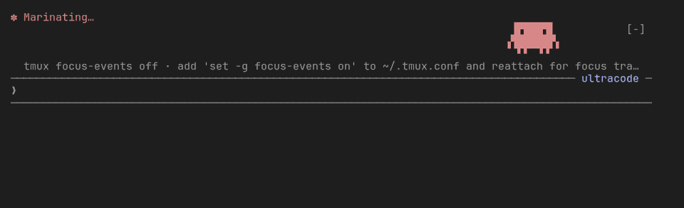
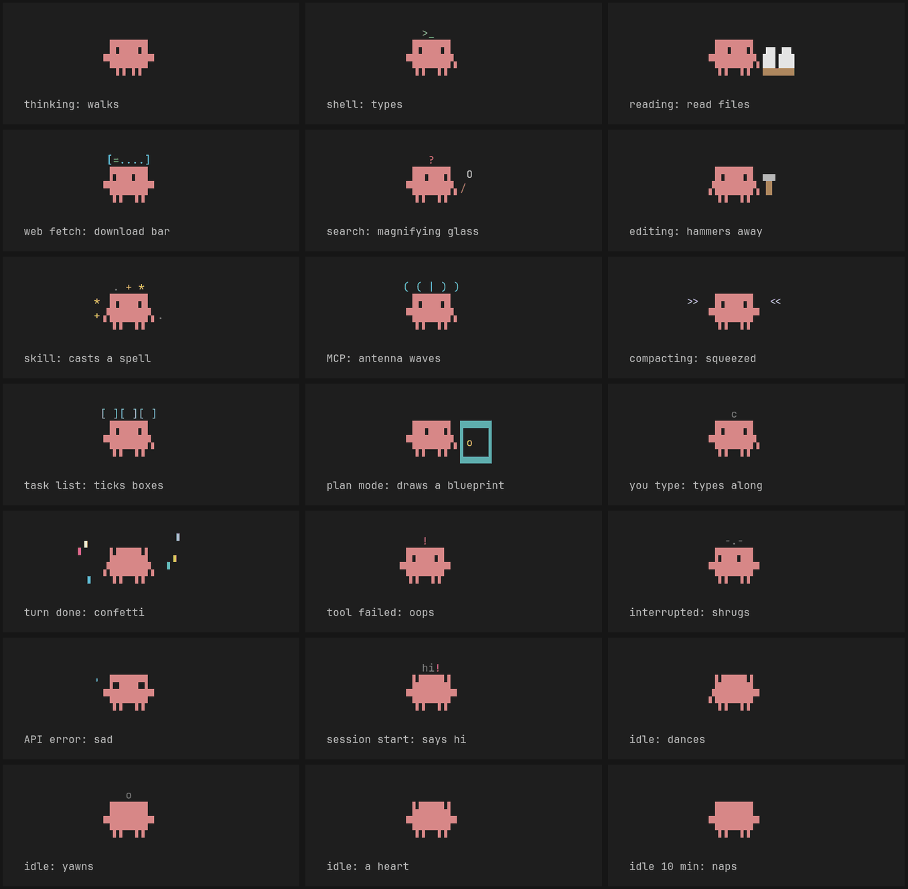
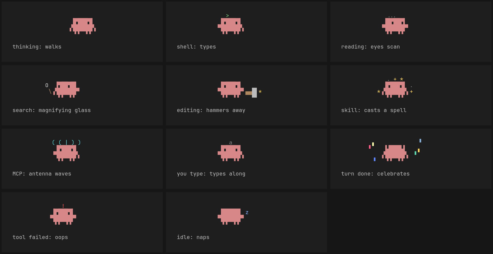
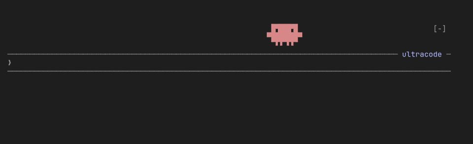
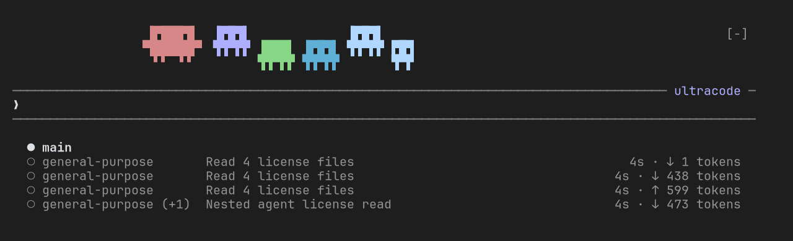
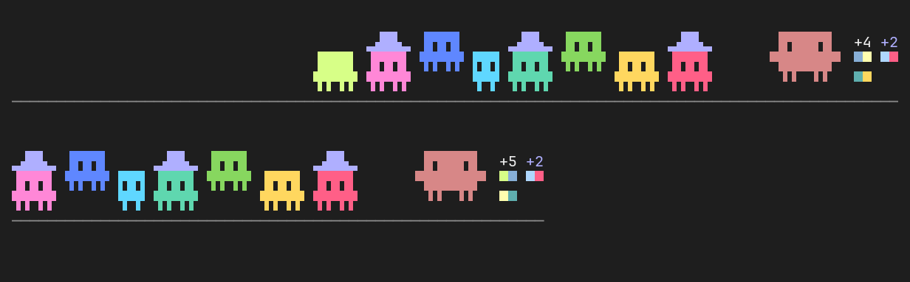
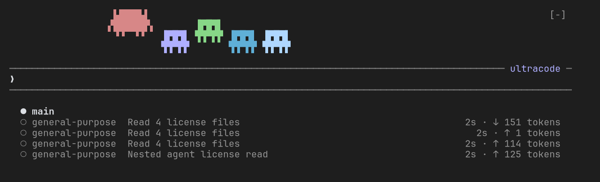
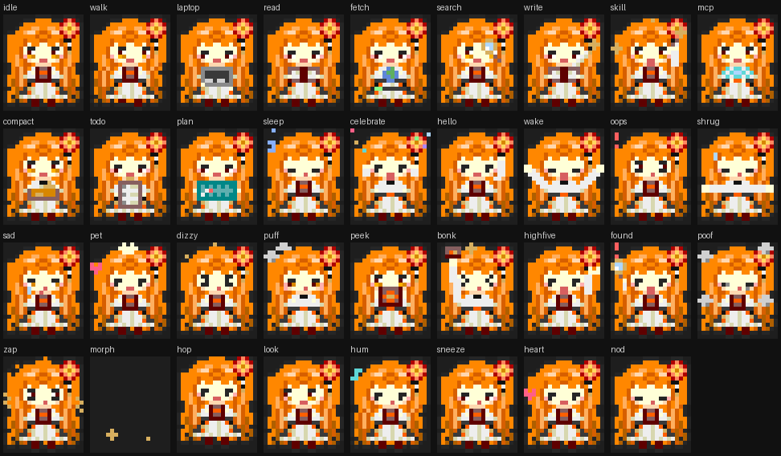
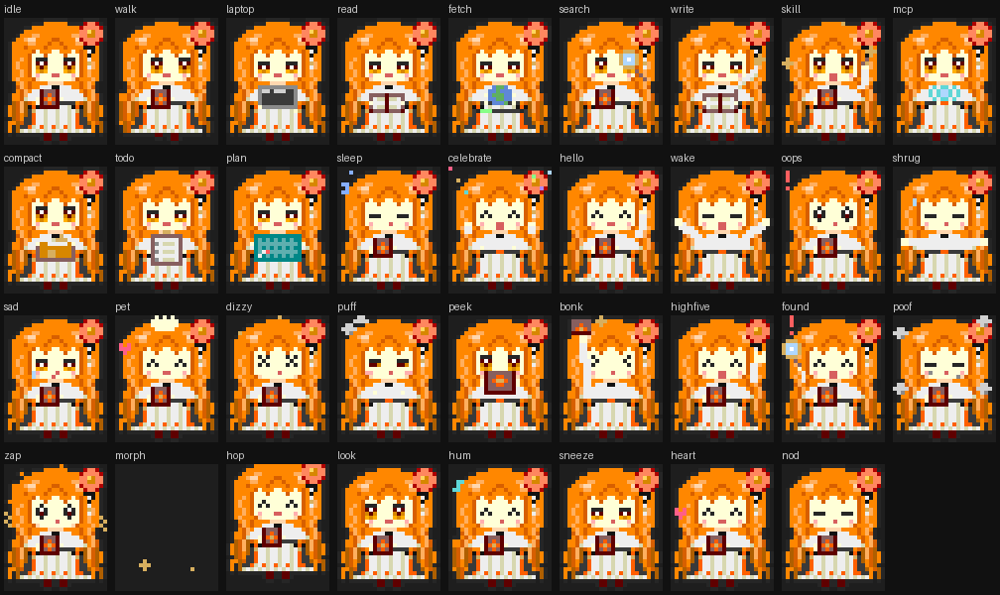

<div align="center">


# clawd

**Claude Code のマスコット Clawd がプロンプトの上に住み、Claude の作業を演じてくれます。**

[](https://github.com/wray-lee/clawd/actions/workflows/ci.yml)
[](https://github.com/wray-lee/clawd/releases)
[](https://claude.com/claude-code)
[](LICENSE)

[English](README.md) | [简体中文](README.zh-CN.md) | 日本語



</div>

## 特長

- **作業を演じる**：Claude が考えている間は歩き回り、シェルコマンドではタイピング、読み込み中はページを掲げ、検索中は虫めがねをかざし、Web ページの取得中はダウンロードバーを見守り、編集中はハンマーを振り、skill では魔法をかけ、MCP 呼び出しでは頭のアンテナから電波を出し、タスクリストではチェックを入れ、plan モードでは設計図を描き、会話の圧縮中は両側から押しつぶされます。
- **サブエージェントごとに小さな Clawd**：実行中のサブエージェント（workflow のエージェントも含む）それぞれに、自分の色の小さな Clawd が付きます。サブエージェントがさらに起動したサブエージェントは、もっと小さくなります。workflow のエージェントは紫のシルクハットをかぶります。エージェントが終わると去っていきます。
- **あなたに反応する**：プロンプトに入力すると一緒にタイピングし、最後に押したキーを掲げます。クリックすると、そのときの状態に合わせて反応します。クリックで Clawd の文字が選択されることはないので、反転表示もコピーもされません。
- **気分がある**：セッションが始まるとあいさつし、ターンが終わるとお祝いし、中断されると肩をすくめ、エラーでは落ち込み、ツールが失敗すると驚き、待っている間は小さなしぐさをし、静かな時間が 10 分続くと眠ります。
- **カラフル**：Clawd はウェルカム画面と同じテーマのオレンジのまま。小さな Clawd は 12 色、紙吹雪、きらきら、`z`、電波、煙にもそれぞれ色があります。すべての文字が 1 カラム幅なので、CJK 端末でもずれません。

## インストール

Claude Code のターミナルセッションのプロンプトで：

```
/plugin install clawd --marketplace wray-lee/clawd
```

`y` でマーケットプレイスを追加し、スコープを選びます（user スコープならすべてのセッションで読み込まれます）。シェルからは：

```sh
claude plugin install clawd --marketplace wray-lee/clawd
```

インストール後、Claude Code を再起動してください。`/clawd` でバンドの表示と非表示を、`/clawd chan` で Claude ちゃんとの入れ替えを切り替えます。

## Clawd のしぐさ



| とき | Clawd |
| --- | --- |
| Claude が考えている | 行ったり来たり歩く |
| シェルコマンドの実行中 | タイピング、頭上に `>_` |
| ファイルの読み込み中 | 開いたページを横に持ち、ときどきめくる |
| Web ページの取得中 | 頭上のダウンロードバー `[==...]` がたまっていく |
| 検索中（Grep、Glob、Web 検索） | 虫めがねを左右にかざす、頭上に `?` |
| ファイルの編集中 | ハンマーを振り、火花が飛ぶ |
| skill の使用中 | 両手を上げ、2 つの火花が頭のまわりを回る |
| MCP ツールの呼び出し中 | 頭のアンテナから `( ( \| ) )` |
| タスクリストを書いている | 頭上の `[x]` に順にチェック |
| plan モードに入る・出る | 青緑の設計図を掲げて道筋を描く |
| 会話の圧縮中 | `>>` と `<<` に終わるまで押しつぶされる |
| セッションが始まった | にっこり目で手を振る、`hi!` |
| ターンが終わった | にっこり目でジャンプ、紙吹雪が舞う |
| ツールが失敗した | `!` とぶるっと震える |
| ターンを中断した | 肩をすくめる、`-.-` |
| ターンがエラーか拒否で終わった | 目を伏せ、涙がこぼれる |
| 何もないとき | まばたきし、8 秒ごとに 14 種のしぐさからランダムに 1 つ：ジャンプ、手を振る、伸び、きょろきょろ、ダンス、鼻歌、あくび、くしゃみ、ハート `<3`、お手玉、しゃがんでジャンプ、星を見る、バンザイ、うとうとしてはっと起きる |
| 10 分たった | `z Z` で眠る、入力すると起きる |
| プロンプトに入力中 | 一緒にタイピング、最後のキーを掲げる |

ツールのしぐさは最低 1.5 秒続くので、すぐ終わる検索や skill も一瞬で消えずに見えます。



ダイアログ（権限の確認や質問）がプロンプトを占めている間は、エンジンがバンドを隠すので Clawd は表示されません。

### サブエージェントの小さな Clawd





- サブエージェントには 5 カラム幅の小さな Clawd、その子サブエージェントには 3 カラム幅のさらに小さな Clawd が付きます。3 階層目より深いものは 1 ピクセルの点になります。入れ子のものは親のすぐ後ろに並びます。
- 色は 12 色のパレット（`hooks/palette.ts`）からランダムに選ばれます。xterm-256 色なので、256 色端末でも同じ色にまとまりません。12 色を使い切るまで、画面上で色がかぶることはありません。
- workflow が起動したエージェントは、`ultracode` ラベルと同じ紫のシルクハットをかぶるので、普通のサブエージェントと見分けられます。体がこの紫になることはありません。
- 小さな Clawd は Clawd の広い側に並びます。通常サイズと小サイズは最大 8 匹まで描かれます。1 ピクセルの点はこの数に含まれず、場所があればすべて描かれます。残りは `[-]` の下に細い 2 列で数えられます。普通のサブエージェントが先、workflow のエージェントが後で、`+N`（workflow はシルクハットの紫）の下にそれぞれの色の点が並びます。小さな Clawd は Clawd のエフェクトを避けるので、ハンマーや紙吹雪が隠れることはありません。
- エンジンがエージェントを完了、失敗、または停止と報告すると去ります。バックグラウンドの作業を待っているサブエージェントの Clawd は残ります。



### Clawd をクリック

| Clawd が | クリックすると |
| --- | --- |
| 待機中 | にっこり目でくすくす笑い、きらきら |
| 眠っている | `!` で目を覚ます |
| 歩いている | くるっと回って目を回す |
| コマンド実行中、圧縮中 | 手で追い払う、`!?` |
| 読み込み、Web 取得、タスクリスト、計画中 | 顔を上げてあなたを見る、`o.o` |
| 編集中 | ハンマーで自分の頭をこつん |
| お祝い中 | ハイタッチ |
| 検索中 | 見つけた！虫めがねを高く掲げて `!` |
| skill の使用中 | 魔法がぽんっと失敗して煙が出る |
| MCP 呼び出し中 | 回線がバチバチする |

> [!NOTE]
> クリックには、端末がマウスを報告するフルスクリーンレイアウトが必要です。tmux では `CLAUDE_CODE_NO_FLICKER=1` を設定してください。バンドは専用の領域に描かれるので、押しても文字の選択は始まりません。



### イースターエッグ

Clawd を素早く 7 回クリックする（または `/clawd chan` を実行する）と、ぽんっと煙が立って Claude ちゃんに交代します。ちびキャラのピクセルアートで、同じ作業を自分のポーズで演じます。そばのヘルパーはフルサイズの Clawd で、workflow のものは今まで通り帽子をかぶります。もう一度で Clawd に戻り、選択はセッションをまたいで保たれます。サイズは 16 行と 12 行の 2 種類で、どちらも手描きです。余裕がなければ小さいほうになり、空きが 12 行未満のときは Clawd が代わりに出てトーストで知らせます。





## 必要なもの

- Claude Code 2.1.319 以降、ターミナルで。バンドを描くのはターミナルだけで、デスクトップ版とモバイルアプリには表示されません。
- プロンプトの上に 4 行の空き。足りないときは Clawd は隠れます。

## よくある質問

<details>
<summary>Clawd をトランスクリプトの背後の本物の背景にできますか？</summary>

できません。ターミナルの mod は自分のバンドの中にしか描けず、バンドの外に置いたものは切り取られます。バンドの横の `[-]` はエンジンが描くもので、プラグインからは消せません。
</details>

<details>
<summary>アップデートを入れたのに変わりません。</summary>

Claude Code を再起動してください。インストール済みのプラグインは起動時に読み込まれ、`/reload-plugins` では新しいバージョンに切り替わりません。
</details>

<details>
<summary>Clawd の動きを止めるには？</summary>

`/clawd` を実行します。隠れている間は何も描かず、再描画もしません。
</details>

## 開発

```sh
git clone https://github.com/wray-lee/clawd
cd clawd
claude --plugin-dir .      # 手元のコードで Claude Code を起動
claude plugin validate .
claude plugin test .
```

構成としぐさの追加方法は [CONTRIBUTING.md](CONTRIBUTING.md) を参照してください。

## 似たプロジェクト

- [zhanbodev/clawd-buddy](https://github.com/zhanbodev/clawd-buddy)
- [CodeChrisB/MyClawd](https://github.com/CodeChrisB/MyClawd)

## ライセンス

[MIT](LICENSE)。Clawd は Anthropic のマスコットです。本プロジェクトはファン作品であり、Anthropic の公式製品ではありません。
