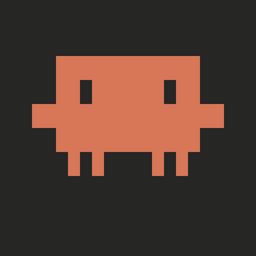

<div align="center">



# clawd

**Claude Code のマスコット Clawd がプロンプトの上に住み、Claude の作業を演じてくれます。**

[](https://github.com/wray-lee/clawd/actions/workflows/ci.yml)
[](https://github.com/wray-lee/clawd/releases)
[](https://claude.com/claude-code)
[](LICENSE)

[English](README.md) | [简体中文](README.zh-CN.md) | 日本語


</div>

## 特長

- **作業を演じる**：Claude が考えている間は歩き回り、シェルコマンドではタイピング、読み込み中は目をきょろきょろ、編集中はハンマーを振ります。
- **サブエージェントごとに小さな Clawd**：実行中のサブエージェント（workflow のエージェントも含む）それぞれに、自分の色の小さな Clawd が付きます。サブエージェントがさらに起動したサブエージェントは、もっと小さくなります。エージェントが終わると去っていきます。
- **あなたに反応する**：プロンプトに入力すると一緒にタイピングし、最後に押したキーを掲げます。クリックすると、そのときの状態に合わせて反応します。
- **気分がある**：ターンが終わるとお祝いし、ツールが失敗すると驚き、静かな時間が 2 分ほど続くと眠ります。
- **どのテーマにもなじむ**：Clawd はウェルカム画面と同じテーマ色で描かれ、小さな Clawd もテーマ色だけを使います。すべての文字が 1 カラム幅なので、CJK 端末でもずれません。

## インストール

Claude Code のターミナルセッションのプロンプトで：

```
/plugin install clawd --marketplace wray-lee/clawd
```

`y` でマーケットプレイスを追加し、スコープを選びます（user スコープならすべてのセッションで読み込まれます）。シェルからは：

```sh
claude plugin install clawd --marketplace wray-lee/clawd
```

インストール後、Claude Code を再起動してください。`/clawd` でバンドの表示と非表示を切り替えます。

## Clawd のしぐさ

| とき | Clawd |
| --- | --- |
| Claude が考えている | 行ったり来たり歩く |
| シェルコマンドの実行中 | タイピング、頭上に `>_` |
| 読み込みや検索の最中 | 目をきょろきょろ、頭上に `...` |
| ファイルの編集中 | ハンマーを振り、火花が飛ぶ |
| ターンが終わった | にっこり目でジャンプ、きらきら |
| ツールが失敗した | `!` とぶるっと震える |
| 何もないとき | まばたき、よそ見、ジャンプ |
| 約 2 分たった | `z Z` で眠る、入力すると起きる |
| プロンプトに入力中 | 一緒にタイピング、最後のキーを掲げる |

### サブエージェントの小さな Clawd


- サブエージェントには 5 カラム幅の小さな Clawd、その子サブエージェントには 3 カラム幅のさらに小さな Clawd が付きます。3 階層目より深いものは 1 ピクセルの点になります。入れ子のものは親のすぐ後ろに並びます。
- 色はテーマ色のパレット（`hooks/palette.ts`）からランダムに選ばれます。パレットを使い切るまで、画面上で色がかぶることはありません。
- 小さな Clawd は Clawd の広い側に並びます。バンドに収まらない分は `+N` と表示されます。
- エンジンがエージェントを完了、失敗、または停止と報告すると去ります。バックグラウンドの作業を待っているサブエージェントの Clawd は残ります。

### Clawd をクリック

| Clawd が | クリックすると |
| --- | --- |
| 待機中 | にっこり目でくすくす笑い、きらきら |
| 眠っている | `!` で目を覚ます |
| 歩いている | くるっと回って目を回す |
| コマンド実行中 | 手で追い払う、`!?` |
| 読み込み中 | 顔を上げてあなたを見る、`o.o` |
| 編集中 | ハンマーで自分の頭をこつん |
| お祝い中 | ハイタッチ |

> [!NOTE]
> クリックには、端末がマウスを報告するフルスクリーンレイアウトが必要です。tmux では `CLAUDE_CODE_NO_FLICKER=1` を設定してください。


## 必要なもの

- Claude Code 2.1.319 以降、ターミナルで。バンドを描くのはターミナルだけで、デスクトップ版とモバイルアプリには表示されません。
- プロンプトの上に 4 行の空き。足りないときは Clawd は隠れます。

## よくある質問

<details>
<summary>Clawd をトランスクリプトの背後の本物の背景にできますか？</summary>

できません。ターミナルの mod は自分のバンドの中にしか描けず、バンドの外に置いたものは切り取られます。バンドの横の `[-]` はエンジンが描くもので、プラグインからは消せません。
</details>

<details>
<summary>アップデートを入れたのに変わりません。</summary>

Claude Code を再起動してください。インストール済みのプラグインは起動時に読み込まれ、`/reload-plugins` では新しいバージョンに切り替わりません。
</details>

<details>
<summary>Clawd の動きを止めるには？</summary>

`/clawd` を実行します。隠れている間は何も描かず、再描画もしません。
</details>

## 開発

```sh
git clone https://github.com/wray-lee/clawd
cd clawd
claude --plugin-dir .      # 手元のコードで Claude Code を起動
claude plugin validate .
claude plugin test .
```

構成としぐさの追加方法は [CONTRIBUTING.md](CONTRIBUTING.md) を参照してください。

## 似たプロジェクト

- [zhanbodev/clawd-buddy](https://github.com/zhanbodev/clawd-buddy)
- [CodeChrisB/MyClawd](https://github.com/CodeChrisB/MyClawd)

## ライセンス

[MIT](LICENSE)。Clawd は Anthropic のマスコットです。本プロジェクトはファン作品であり、Anthropic の公式製品ではありません。
