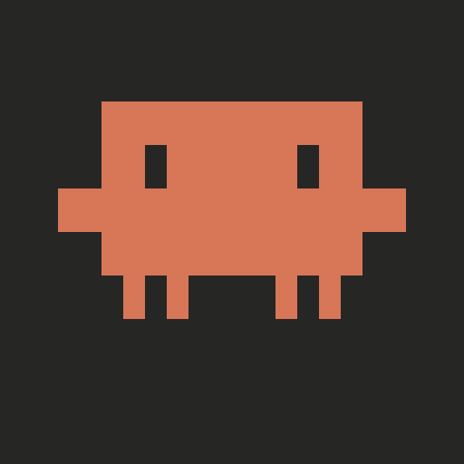
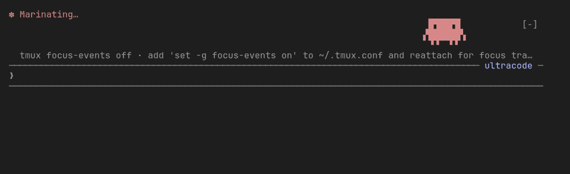
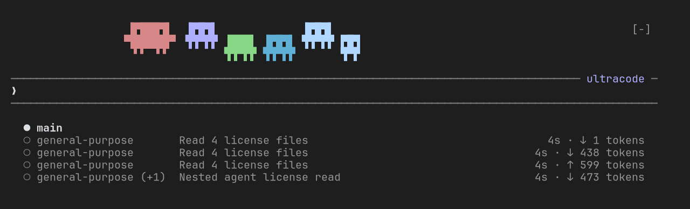
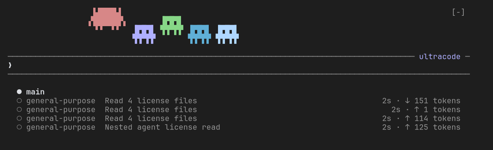

<div align="center">



# clawd

**Clawd, the Claude Code mascot, lives above your prompt and acts out what Claude is doing.**

[](https://github.com/wray-lee/clawd/actions/workflows/ci.yml)
[](https://github.com/wray-lee/clawd/releases)
[](https://claude.com/claude-code)
[](LICENSE)

English | [简体中文](README.zh-CN.md) | [日本語](README.ja.md)



</div>

## Features

- **Acts out the work.** Clawd walks while Claude thinks, types at a shell
  command, scans with its eyes while reading, and hammers while editing.
- **A helper per subagent.** Each running subagent, workflow agents included,
  gets a small Clawd in its own color. A subagent's own subagents are smaller
  still. Each helper leaves when its agent finishes.
- **Reacts to you.** Clawd types along with you in the prompt and holds up the
  last key. Click it and it reacts to what it is doing.
- **Moods.** Clawd celebrates a finished turn, startles when a tool fails, and
  naps after two quiet minutes.
- **Fits any theme.** Clawd uses the welcome screen's own theme color, and the
  helpers use theme colors too. Every glyph is one column wide, so CJK
  terminals stay aligned.

## Install

At the prompt of a Claude Code terminal session:

```
/plugin install clawd --marketplace wray-lee/clawd
```

Answer `y` to add the marketplace, then pick a scope. User scope loads Clawd in
every session. From a shell:

```sh
claude plugin install clawd --marketplace wray-lee/clawd
```

Restart Claude Code to load it. `/clawd` hides or shows the band.

## What Clawd does

| When | Clawd |
| --- | --- |
| Claude is thinking | walks back and forth |
| a shell command runs | types, `>_` above |
| Claude reads or searches | eyes scan, `...` above |
| Claude edits files | hammers, sparks fly |
| a turn finishes | happy eyes, hops, sparkles |
| a tool fails | `!` and a shake |
| nothing happens | blinks, glances, hops |
| about 2 minutes pass | sleeps with `z Z`, wakes when you type |
| you type in the prompt | types along, holds up your last key |

### Helpers for subagents



- Each subagent gets a 5-column helper, and a subagent's own subagent gets a
  3-column one. Three levels down and deeper, a helper is a single pixel.
  Each nested helper stands right after its parent.
- Each helper's color is picked at random from a palette of theme colors
  (`hooks/palette.ts`). No two helpers on screen share a color until the
  palette runs out.
- Helpers line up on the side of Clawd that has room. When the band is full,
  the rest show as `+N`.
- A helper leaves when the engine reports its agent as completed, failed or
  killed. A subagent that is still waiting on background work keeps its helper.

### Click Clawd

| Clawd is | A click |
| --- | --- |
| idle | giggles with happy eyes and sparkles |
| asleep | wakes up with a `!` |
| walking | spins around, dizzy |
| running a command | waves you off, `!?` |
| reading | looks up at you, `o.o` |
| editing | bonks its own head with the hammer |
| celebrating | gives a high five |

> [!NOTE]
> Clicks need the fullscreen layout, where the terminal reports the mouse. In
> tmux, set `CLAUDE_CODE_NO_FLICKER=1`.



## Requirements

- Claude Code 2.1.319 or newer, in a terminal. Only the terminal draws the
  band; the desktop and mobile apps do not show it.
- 4 free rows above the prompt. With less room, Clawd stays hidden.

## FAQ

<details>
<summary>Can Clawd be a real background behind the transcript?</summary>

No. Terminal mods draw in bands of their own, and the band clips anything
positioned outside it. The `[-]` beside the band is the engine's, so a plugin
cannot remove it.
</details>

<details>
<summary>I installed an update and nothing changed.</summary>

Restart Claude Code. An installed plugin loads at startup, and
`/reload-plugins` does not pick up a new version.
</details>

<details>
<summary>How do I make Clawd stop moving?</summary>

Run `/clawd`. A hidden Clawd draws nothing and does not redraw.
</details>

## Develop

```sh
git clone https://github.com/wray-lee/clawd
cd clawd
claude --plugin-dir .      # run Claude Code with your checkout
claude plugin validate .
claude plugin test .
```

See [CONTRIBUTING.md](CONTRIBUTING.md) for the layout and how to add an action.

## Similar projects

- [zhanbodev/clawd-buddy](https://github.com/zhanbodev/clawd-buddy)
- [CodeChrisB/MyClawd](https://github.com/CodeChrisB/MyClawd)

## License

[MIT](LICENSE). Clawd is Anthropic's mascot. This is a fan project, not an
Anthropic product.
