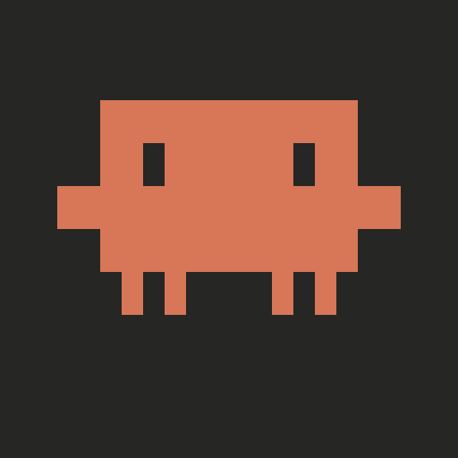
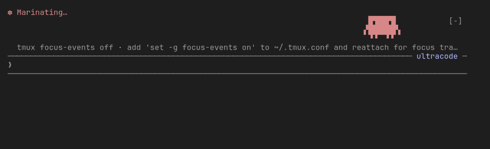
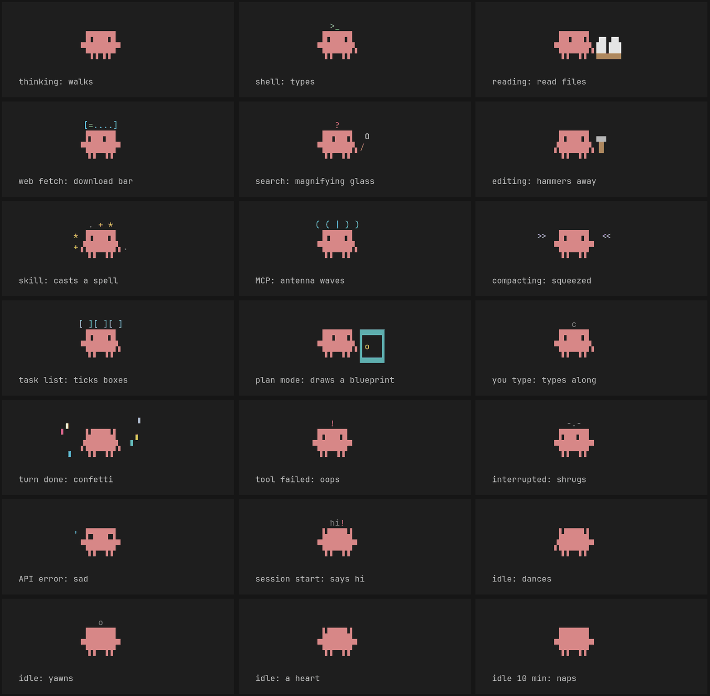
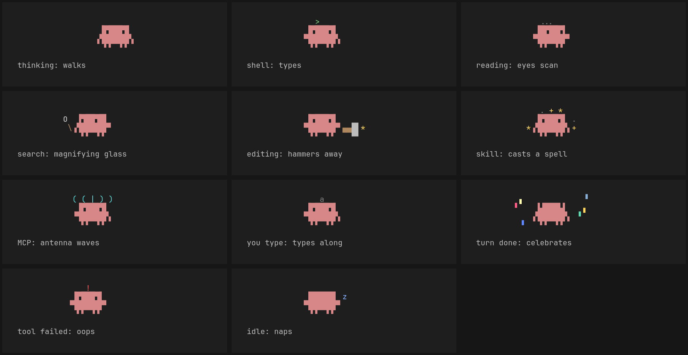
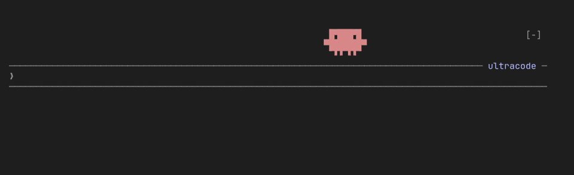
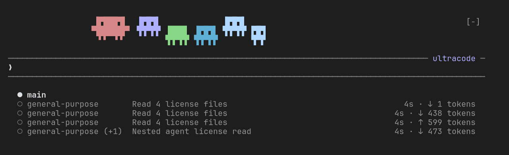
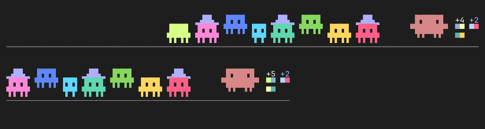
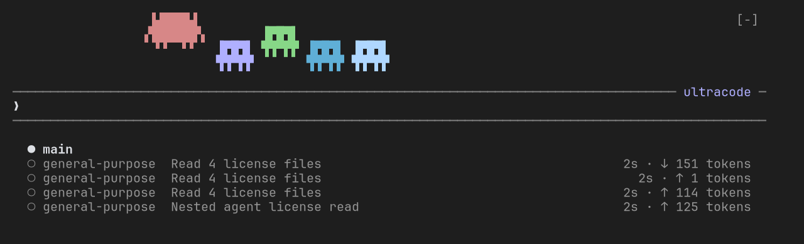

<div align="center">



# clawd

**让 Claude Code 的吉祥物 Clawd 住在输入框上方，把 Claude 正在做的事演出来。**

[](https://github.com/wray-lee/clawd/actions/workflows/ci.yml)
[](https://github.com/wray-lee/clawd/releases)
[](https://claude.com/claude-code)
[](LICENSE)

[English](README.md) | 简体中文 | [日本語](README.ja.md)



</div>

## 特性

- **把工作演出来**：Claude 思考时来回走，跑命令时打字，读文件时眼睛左右扫，搜索时举放大镜，改代码时挥锤子，用 skill 时施魔法，调 MCP 时头顶天线发信号。
- **每个子代理一只小 Clawd**：每个运行中的子代理（包括 workflow 里的）都有一只自己颜色的小 Clawd。子代理再开的子代理更小。workflow 的代理戴一顶紫色礼帽。代理结束，小 Clawd 就离开。
- **会回应你**：你在输入框打字时它跟着打，头顶举着你刚按的键；点它一下，它按当前状态做出反应。点击永远不会选中 Clawd 的文字，所以不会反色，也不会被复制。
- **有情绪**：一轮回答完成会庆祝，工具出错会吓一跳，安静两分钟后睡着。
- **色彩丰富**：Clawd 保留欢迎界面同款主题橙色；小 Clawd 有 12 种颜色，彩纸、星星、`z`、信号、烟雾也各有颜色。所有字符都是单列宽，CJK 终端不会错位。

## 安装

在 Claude Code 终端会话的输入框里：

```
/plugin install clawd --marketplace wray-lee/clawd
```

按 `y` 添加 marketplace，再选作用域（user 作用域在每个会话加载）。也可以在 shell 里：

```sh
claude plugin install clawd --marketplace wray-lee/clawd
```

装好后重启 Claude Code。`/clawd` 隐藏或显示横栏。

## Clawd 会做什么



| 时机 | Clawd |
| --- | --- |
| Claude 思考时 | 来回走 |
| 运行 shell 命令时 | 打字，头顶 `>_` |
| 读文件或网页时 | 眼睛左右扫，头顶 `...` |
| 搜索时（Grep、Glob、网页搜索） | 左右举放大镜，头顶 `?` |
| 编辑文件时 | 挥锤，冒火花 |
| 使用 skill 时 | 举起双手，两串火花绕着头转 |
| 调用 MCP 工具时 | 头顶天线发出 `( ( \| ) )` |
| 一轮回答完成时 | 笑眼、蹦跳、撒彩纸 |
| 工具出错时 | `!` 加抖一下 |
| 空闲时 | 眨眼、张望、蹦一下 |
| 空闲约 2 分钟后 | 睡觉冒 `z Z`，你一打字就醒 |
| 你在输入框打字时 | 跟着打字，举着你刚按的键 |

每个工具的动作至少播放 1.5 秒，快速的搜索或 skill 也看得到，不会一闪而过。



### 子代理小 Clawd





- 每个子代理一只 5 列宽的小 Clawd；子代理开出的子代理是 3 列宽的更小一只；第三层及更深的只画成一个像素点。每只都紧跟在它的父代理后面。
- 颜色从 12 种颜色的色库（`hooks/palette.ts`）里随机挑。都是 xterm-256 色，256 色终端里也不会混成一样；12 种用完之前，同屏的小 Clawd 不会撞色。
- workflow 启动的代理戴一顶礼帽，颜色是 `ultracode` 标签的紫色，一眼就能和普通子代理区分。小 Clawd 的身体永远不会是这种紫色。
- 小 Clawd 排在 Clawd 空间更大的那一侧。完整和小号的最多画 8 只；像素点不算在内，有空间就都画出来。其余的在 `[-]` 下方纵向排成两窄列：先是普通子代理，再是 workflow 代理，各自是 `+N`（workflow 的用礼帽紫色），下面是每只对应颜色的像素点。小 Clawd 会避开 Clawd 的特效，锤子、彩纸都不会被挡住。


- 引擎报告代理已完成、失败或被终止时，小 Clawd 离开；还在等后台任务的子代理会继续留着。

### 点击 Clawd

| Clawd 正在 | 点一下 |
| --- | --- |
| 空闲 | 笑眼咯咯笑，冒星星 |
| 睡觉 | 被叫醒，头顶 `!` |
| 走路 | 原地转身，晕乎乎 |
| 跑命令 | 挥手赶你，`!?` |
| 看书 | 抬头看你，`o.o` |
| 敲代码 | 锤子砸到自己头上 |
| 庆祝 | 和你击掌 |
| 搜索 | 找到了！举起放大镜，`!` |
| 用 skill | 魔法失败，噗地冒一团烟 |
| 调 MCP | 信号滋滋作响 |

> [!NOTE]
> 点击需要全屏布局（终端才会上报鼠标）。在 tmux 里请设置 `CLAUDE_CODE_NO_FLICKER=1`。横栏画在自己的独立区域里，按下去不会开始选中文字。



## 要求

- Claude Code 2.1.319 或更新版本，在终端里使用。横栏只在终端绘制，桌面版和手机 App 不显示。
- 输入框上方需要 4 行空间，不够时 Clawd 自动隐藏。

## 常见问题

<details>
<summary>Clawd 能做成对话记录后面的真背景吗？</summary>

不能。终端里的 mod 只能画在自己的横栏里，超出横栏的内容会被裁掉。横栏旁边的 `[-]` 是引擎画的，插件去不掉。
</details>

<details>
<summary>装了新版本但没变化？</summary>

重启 Claude Code。已安装的插件在启动时加载，`/reload-plugins` 不会换成新版本。
</details>

<details>
<summary>怎么让 Clawd 别动了？</summary>

运行 `/clawd`。隐藏后什么都不画，也不再重绘。
</details>

## 开发

```sh
git clone https://github.com/wray-lee/clawd
cd clawd
claude --plugin-dir .      # 用本地代码启动 Claude Code
claude plugin validate .
claude plugin test .
```

目录结构和新增动作的方法见 [CONTRIBUTING.md](CONTRIBUTING.md)。

## 类似项目

- [zhanbodev/clawd-buddy](https://github.com/zhanbodev/clawd-buddy)
- [CodeChrisB/MyClawd](https://github.com/CodeChrisB/MyClawd)

## 许可证

[MIT](LICENSE)。Clawd 是 Anthropic 的吉祥物，本项目是粉丝作品，不是 Anthropic 官方产品。
